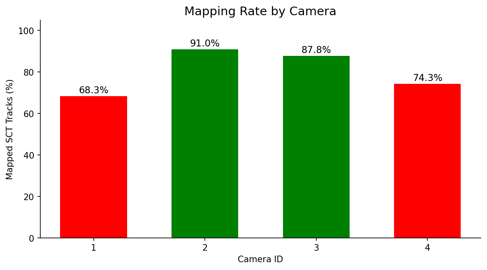
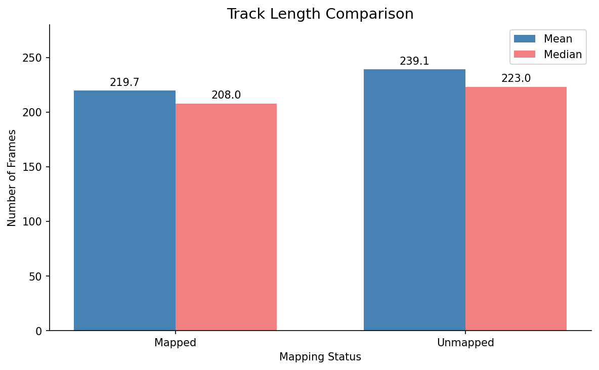

# Data Cleaning & Preparation

[cleaning.ipynb](cleaning.ipynb) prepares the RoundaboutHD Single-Camera Tracking (SCT), Multi-Camera Tracking (MTMC), and vehicle attribute annotations. It cleans observations, links SCT tracks to global vehicle IDs, and produces validated tables for later analysis.

## Cleaning Steps

- Load annotations from `data/RoundaboutHD.zip` and inspect their structure, missing values, and observation keys.
- Retain incomplete attribute records. Keep the largest box per observation key, removing 26 duplicate observations from each tracking dataset.
- Validate bounding boxes and clip them to the 3840 × 2160 image boundaries. No boxes are removed as invalid in the current run.
- Standardize attribute spacing, capitalization, and spelling variants while preserving original annotations and track links from notes.
- Match boxes within the same camera and frame using intersection over union (IoU) > 0.5. Rank candidates by unique matched frames, then mean IoU, with deterministic tie-breaking.
- Accept matches with at least 3 matched frames and mean IoU >= 0.7, provided they pass the same-camera consistency check. Flag low-confidence candidates and simultaneous assignments of different tracks to the same global ID as `review`.
- Compare vehicle attributes across accepted matches. Keep agreed values; leave conflicting attributes missing and retain conflict flags.
- Integrate accepted IDs and resolved attributes. Validate row counts, unique keys, boxes, and mapping relationships, then read back the exported CSV files.

## Data Quality Checks & Findings

These checks investigate data quality during preparation.

| Check | Finding |
| --- | --- |
| Track duration | Initially unmapped tracks are not generally shorter: mean 239.1 frames versus 219.7 for mapped tracks; medians are 223 and 208. |
| Temporal overlap | 204 of 205 initially unmapped tracks share camera/frame combinations with MTMC annotations. |
| Spatial overlap | None of the 205 initially unmapped tracks reaches IoU 0.5; the highest observed IoU is approximately 0.375. |
| Matching quality | Of 837 initial matches, 832 are accepted and 5 are flagged for review: 3 low-confidence matches and 2 conflicting simultaneous assignments. |
| Attribute consistency | 21 of 311 MTMC vehicles have conflicting annotations. |

Track duration and temporal overlap do not justify assigning the missing IDs. All SCT tracks are retained; the 205 initially unmapped tracks and 5 review tracks leave 210 tracks without a confirmed global ID. Conflicting attributes are left missing and flagged, with no vehicles removed for conflicts.

The two additional review matches are camera 3 tracks 78 and 86, both assigned candidate ID 644 despite occupying different positions in six shared frames. Both assignments remain unconfirmed; the IoU and frame-count thresholds are unchanged.

## Visualizations

### Mapping Rate by Camera

The initial mapping rate includes accepted and review candidates.



### Track Length Comparison: Mapped vs. Unmapped

The comparison uses the 837 initially mapped tracks and 205 tracks without a candidate match.



## Cleaned Data & Outputs

The notebook writes the following files to `data/processed/`. Counts are from the latest notebook execution.

| File | Rows | Contents |
| --- | ---: | --- |
| `sct_clean.csv` | 232,919 observations | Cleaned SCT boxes, original and standardized attributes, match status, and accepted global IDs. |
| `mtmc_clean.csv` | 177,756 observations | Cleaned MTMC boxes with resolved vehicle attributes and conflict flags. |
| `vehicle_attributes_resolved.csv` | 311 vehicles | One attribute record per global vehicle, with unresolved conflicts marked as missing and flagged. |
| `track_mapping_quality.csv` | 837 evaluated matches | Best candidate per initially matched SCT track, supporting match statistics, and acceptance status. |

Vehicle IDs on `review` rows in `track_mapping_quality.csv` remain candidates, with the reason recorded in `review_reason`. The SCT table has 50,048 observations without an accepted global ID. Missing attribute records are distinguished from unresolved conflicts. Validation finds no duplicate observation keys, resolved vehicle IDs, or simultaneous accepted assignments of different tracks to the same camera/global vehicle ID.

## How to Run

1. From the project root, use Python 3.9 and `uv` to set up the environment defined by `pyproject.toml` and `uv.lock`:

   ```bash
   uv sync --locked
   ```

   `requirements.txt` also contains an exported dependency list.

2. Place the original archive at `data/RoundaboutHD.zip`. Keep its internal folder structure unchanged; extraction is not required. The dataset and processed CSV files are excluded from Git.

3. Launch JupyterLab from the project root:

   ```bash
   uv run jupyter lab cleaning.ipynb
   ```

   Select the project environment as the notebook kernel, restart it, and run all cells from top to bottom. The notebook uses the working directory as `PROJECT_DIR`.

4. Find the cleaned CSV files in `data/processed/` and the two chart PNGs in `figures/`. Running the notebook again overwrites these generated files.

## Limitations

- Some SCT tracks cannot be reliably assigned global vehicle IDs. Temporal overlap alone does not establish vehicle correspondence.
- Some vehicle attributes contain conflicting annotations that remain unresolved.
- The IoU and acceptance thresholds are heuristic project choices and have not been independently validated. Accepted matches may still contain errors.
